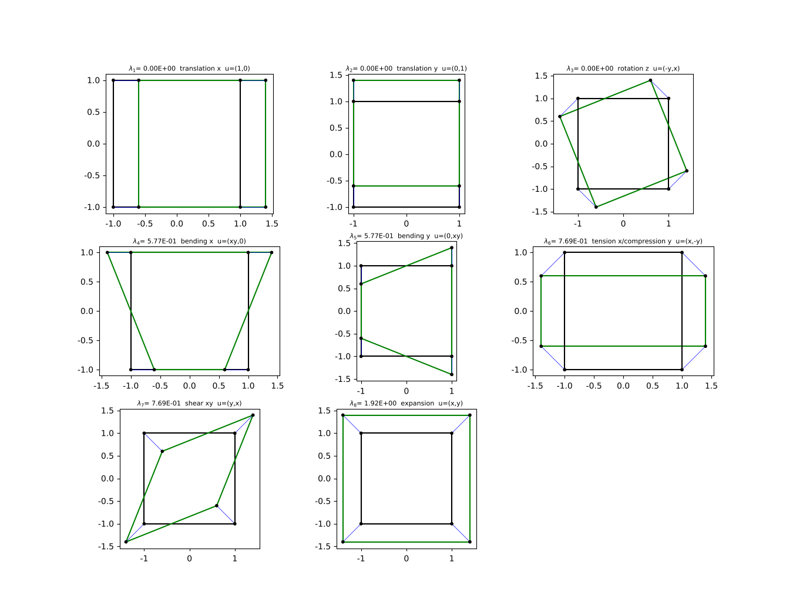
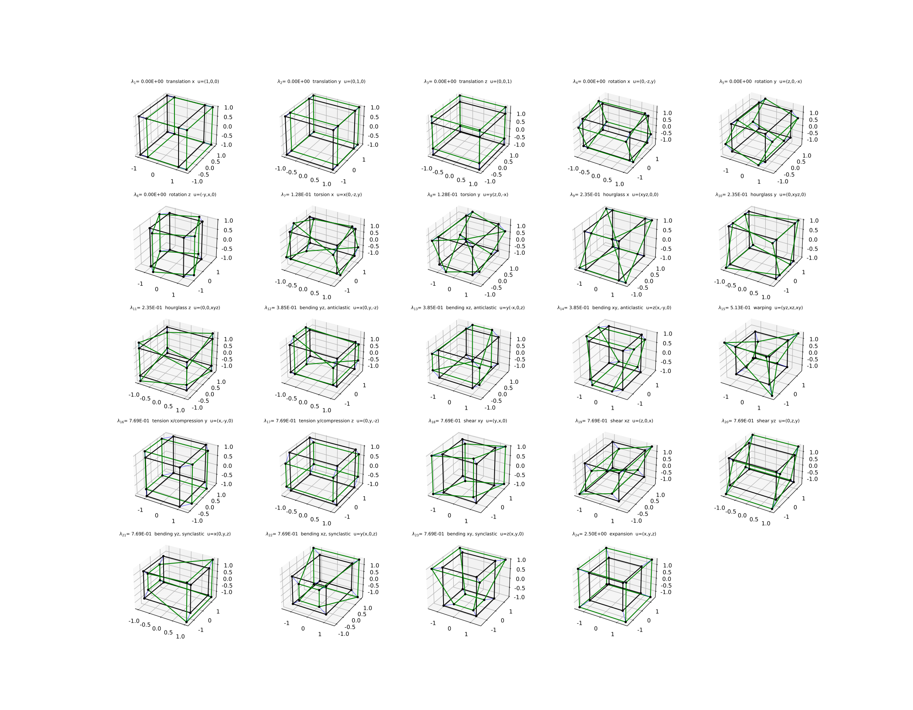

# feigen

[](https://github.com/willklausler/feigen/actions/workflows/ci.yml)
[](https://willklausler.github.io/feigen/)
[](LICENSE)

Stiffness eigenmodes of a single finite element: feigen solves K·φ = λφ, names
every mode and plots it. Rigid-body and hourglass modes show up as zero
eigenvalues.

```sh
fpm run -- -e qua -d 1          # 4-node quad, one cubature point
# cubature points: 1, zero modes: 5
#  mode    eigenvalue  match  name
#     1   0.00000E+00  100.%  translation x  u=(1,0)
#     ...
#     4   0.00000E+00  100.%  bending x  u=(xy,0)      <- hourglass
#     ...
# wrote qua_p1_lag.png
fpm run -- -e hex -p 2 -f serendipity -o hex20.svg
fpm run -- --help
```

The `--` separates fpm's options from feigen's; after `fpm install`, run
`feigen -e hex` directly. The same steps are a library, module `feigen`:

```fortran
q = cubature(CUB_QUA, 1)                    ! one point: reduced integration
s = shapefunc(q, 1)                         ! 4-node quadrilateral
K = stiffness(s, q, s%coords, material(2, 1._dp, 0.3_dp))
call modes(K, lambda, phi)
print *, count(lambda == 0)                 ! 5: 3 rigid-body + 2 hourglass
call name_modes(s%coords, lambda, phi, names, match)
call plot_modes(s, s%coords, lambda, phi, names, 0.2_dp, 'modes.svg')
```



> Coding agents: the complete API reference is [llms.txt](llms.txt), and
> contributor instructions are in [AGENTS.md](AGENTS.md).

## Features

- Lines, triangles, quadrilaterals, tetrahedra, hexahedra and wedges of any order, and
  serendipity quadrilaterals and hexahedra
  ([fortran_shapefuncs](https://github.com/willklausler/fortran_shapefuncs)).
- Any cubature degree, default `2*order`, to show the hourglass modes of reduced
  integration ([fortran_cubatures](https://github.com/willklausler/fortran_cubatures)).
- Reference or distorted geometry: `--coords` reads one node per line.
- Isotropic linear elastic material; plane strain in 2D.
- Mode names (translation, rotation, expansion, tension/compression, shear, bending,
  torsion, warping, hourglass) with a match percentage; complete for linear line, quad
  and hex elements.
- One PNG, SVG or PDF with a subplot per mode, named after the element by default
  (`qua_p1_lag.png`), drawn with [fplotlib](https://github.com/certik/fplotlib).

Conventions: degrees of freedom node by node, Voigt order xx, yy, zz, xy, xz, yz, and
eigenvalues below `1e-10*max|λ|` are exactly zero.

## Installation

With [fpm](https://fpm.fortran-lang.org) 0.13 or later:

```sh
git clone https://github.com/willklausler/feigen && cd feigen
fpm install --profile release       # puts feigen in ~/.local/bin
```

To use the module in your own fpm project, add to your `fpm.toml`:

```toml
[dependencies]
feigen = { git = "https://github.com/willklausler/feigen", tag = "v0.1.0" }
```

There is no make build: the dependencies stdlib, fplotlib and FLAP are fpm packages.

## Documentation

- [User manual and API documentation](https://willklausler.github.io/feigen/), generated with FORD (`tools/doc.sh`)
- [llms.txt](llms.txt): the API reference and the program's options as one plain-text file, also the manual's source
- `man ./man/feigen.3` ([man/feigen.3](man/feigen.3))
- Example programs in [example/](example/) (`fpm run --example --all`) and the program in [app/](app/) (`fpm run`)



## Compilers

CI tests every push on:

| Compiler | Linux | macOS | Windows |
| --- | --- | --- | --- |
| gfortran 14 | yes | yes | yes |
| gfortran 13 | yes | | |
| ifx 2026 | yes | | yes |
| LLVM flang 21 | yes | | |

nvfortran cannot build the dependencies stdlib and fplotlib; see
[llms.txt](llms.txt#compiler-notes).

## Why feigen?

Checking the eigenvalues of an element stiffness matrix is a standard test of a new
element: the number of zero eigenvalues must equal the number of rigid-body modes, and
any extra zero is a spurious (hourglass) mode [1, 2]. The test is usually a throwaway
script. General finite element codes compute eigenmodes of an assembled model, usually
vibration modes with a mass matrix, and do not name them. feigen runs the test for every
element of fortran_shapefuncs from one command line, names the modes and draws them.

## References

1. R. D. Cook, D. S. Malkus, M. E. Plesha, R. J. Witt, *Concepts and Applications of Finite Element Analysis*, 4th ed., Wiley, 2002.
2. K.-J. Bathe, *Finite Element Procedures*, Prentice Hall, 1996.
3. D. P. Flanagan, T. Belytschko, A uniform strain hexahedron and quadrilateral with orthogonal hourglass control, *International Journal for Numerical Methods in Engineering* 17(5), 679–706, 1981. [doi:10.1002/nme.1620170504](https://doi.org/10.1002/nme.1620170504)
4. O. C. Zienkiewicz, R. L. Taylor, J. Z. Zhu, *The Finite Element Method: Its Basis and Fundamentals*, 6th ed., Butterworth-Heinemann, 2005.

The stiffness matrix and the plane-strain material are standard [2, 4]. The hourglass
fields follow Flanagan and Belytschko [3]. The code has not been independently reviewed.

## Status and support

Version 0.1.0. The API may still change before 1.0; changes are recorded in
[CHANGELOG.md](CHANGELOG.md). Bug reports, questions and pull requests are
welcome on [GitHub](https://github.com/willklausler/feigen/issues);
see [CONTRIBUTING.md](CONTRIBUTING.md). To cite this package, use
[CITATION.cff](CITATION.cff).

## License

[MIT](LICENSE)
